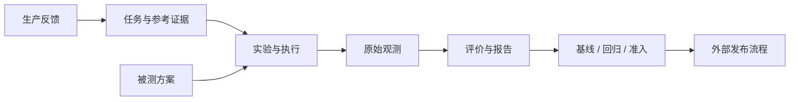

# Decision Lab 架构

状态：设计基线，能力按实施计划逐步交付。更新：2026-11-01。

## 1. 目标与范围

为生产决策方案提供可复现、可追溯、可审计的评价与回归证据，支撑业务范围内的准入、版本替换和持续质量治理。核心产出是绑定方案、任务、评价与门禁版本的结论及证据链。

首发支持文本/JSON 的类型化决策与显式单步策略，面向单组织受控部署。Jev/CLEF 与 LLM 可以完成同一任务；接口协议由适配器处理。生成任务、多步环境、在线反馈按独立能力扩展。平台不执行业务动作，评测结论、人工批准和部署是独立事实。

本地是开发及可选部署形态。运行规模、服务目标、恢复目标和权限边界经过验证，才能声明对应规格可用于生产。当前代码仍是待演进原型。

## 2. 原则及其依据

| 原则 | 理论依据 | 工程约束 |
| --- | --- | --- |
| 按业务语义划分边界 | 领域驱动设计：限界上下文和聚合界定一致性 | 领域定义不依附模型供应商、HTTP 格式或数据库表；先确立不变量，再设计接口 |
| 被测对象是完整方案 | 实验设计：结论必须对应实际处理条件 | 模型、提示/任务表达、转换器、策略均有版本；变更任一因素产生新方案修订 |
| 观察事实与评价结论分离 | 测量效度：代理指标不等同于业务目标 | 原始响应先保存，评价可复算；分别测量判断、动作与流程效果 |
| 比较条件固定、取舍明确 | 配对实验与统计推断；决策理论的损失/效用 | 同任务逐例比较；规则先于实验发布；关键约束、业务损失和不确定性不能被平均分掩盖 |
| 发布版本不可变 | 实验可追溯性与数据来源治理 | 任务、参考依据、方案、评价、门禁版本不能原地覆盖；重算产生新报告 |
| 显式处理失败与不确定性 | 分布式系统中的部分失败 | 本地幂等不等于远端 exactly-once；执行失败、无效输出、评分失败和答错分别记录 |
| 以最小闭环逐步演进 | 模块化与依赖倒置 | 领域保持纯逻辑，存储/网络依赖接口；增量交付完整行为，实际需求出现后再增加抽象 |

同一实验中的相关问题不是天然独立样本。区间估计和显著性检验应以场景/独立采样单元为依据；比较方法、最低样本和允许变化范围由评价/门禁版本预先声明。开发/调阈值使用的数据与最终测试集隔离。

## 3. 统一语言与领域边界

| 上下文 | 核心模型与职责 | 一致性边界 |
| --- | --- | --- |
| 任务与证据 | TaskDefinition 定义输入/允许结果；CaseRevision 为具体样例；ReferenceEvidence 提供标签、规则、测试或偏好；SuiteRevision 固定样例集合与划分 | EvaluationSuite 发布时验证引用完整性；旧版本不随编辑变化 |
| 被测方案 | SubjectRevision 组合模型引用、任务表达/提示、输出转换、可选动作策略；Endpoint 和 CredentialRef 是调用配置 | EvaluationSubject 发布版本固定；密钥仅引用，实际调用记录凭据修订标识 |
| 实验与执行 | ExperimentPlan 固定方案、任务集、评价版本、重复/采样、预算与执行策略；Execution 为一个方案×场景×轮次；Attempt 是一次实际尝试；Observation 保存执行证据 | Experiment 创建幂等且原子展开执行单元；Execution 独立控制状态与租约，避免整份实验成为大聚合 |
| 评价与分析 | EvaluationPlanRevision 指定证据要求与 Evaluator；Assessment 为逐项评价；Report 固定评价结果、指标分母和来源 | Report 修订不可覆盖；规则、程序、人评、模型裁判均记录版本与有效性 |
| 回归与准入 | BaselineBinding 指定比较起点；GatePolicyRevision 定义配对比较、关键切片、样本要求与硬约束；AdmissionAssessment 给出结论 | 政策运行前发布；结论绑定完整版本与有效期；人工 Approval/Exception 独立留档 |

聚合内用事务维护不变量；跨上下文通过 ID/版本引用协作。首个闭环使用明确应用服务调用，出现异步消费需求时再引入领域事件与事务 outbox；不为未实现的上下文建立空服务或空表。

## 4. 证据、评价与准入约定

**证据链：** `方案与任务快照 → Execution → Attempt → Observation → Assessment → Report → AdmissionAssessment`。每个环节可定位前序版本和来源。请求模型标识、实际返回标识、时间及可获得的模型 revision 都需保存；供应商不提供权重版本时明确为未知。

Adapter 只收到允许发送的输入，不能取得参考答案。类型化答案、候选概率、token 概率、自述置信度分别声明语义；缺失证据对应指标为不适用。接口 confidence 不作为正确概率。模型裁判失败属于评价错误。

| 指标 | 口径 |
| --- | --- |
| 调用成功率 | 成功的提供商业务响应 / 已终结且实际发出的尝试；不确定尝试不算成功，单独计数 |
| 输出有效率 | 通过契约校验的判断 / 已终结且开始执行单元中的计划判断；每单元使用已声明的尝试选择规则 |
| 有效判断准确率 | 正确判断 / 有效且有适用参考依据的判断 |
| 端到端成功率 | 成功判断 / 已终结且开始执行单元中的计划判断；执行/解析/评价错误不当作成功，分别列原因 |
| 决策/流程效果 | 在任务约定的成本、约束和终止条件下计算；无相应证据时不提供 |
| 概率与效率 | Brier/NLL/ECE、延迟和用量分别按适用证据计算，标明样本数、计量范围；未知用量不填 0 |

取消、未开始和无参考依据的判断单独显示。重试不增加任务判断分母；首次尝试和按策略选定的尝试分别保留，不从结果中挑最高分。只有适用的证据才进入对应指标。

回归按同任务、同评价版本逐例配对，区分保持、修复、退步与共同失败，并检查业务关键切片。基线不是正确答案，候选也需独立满足参考依据。标签分布/来源变化触发调查，不能无标签地推断准确率下降。

准入结论使用四态：`passed`（强制规则满足且证据充分）、`failed`（明确违规）、`inconclusive`（样本/统计依据不足，需复核）、`blocked`（执行或评价不可完成、必要证据缺失/过期、版本不匹配）。同时出现确定违规和缺失证据时保留全部原因，结论为 failed；没有确定违规时，blocked 优先于 inconclusive，均不能准入。规则应区分“确定违反零容忍约束”和“统计上支持的退步”，不能把小样本波动解释成确定退步。

外部发布系统检查结论绑定的方案、任务、评价、门禁版本及有效性。人工例外有责任人、原因、范围和期限，不修改机器报告。历史结论通过失效/撤销记录终止使用，不删除证据。

## 5. 执行与恢复约定

创建实验在短事务中冻结计划并建立唯一执行单元；领取单元时生成 Attempt、lease 和 generation，网络等待不持有事务。收到响应后先保存原文，再做归一化与评价；只有持有有效 generation 的执行者能提交当前状态。

Execution 状态为 `queued → running → succeeded | failed | interrupted | cancelled`，策略重试增加 `retry_wait`；运行状态与回答正确与否无关。部分判断无效保留有效证据并标明错误；Experiment 状态由执行进度和暂停/取消控制派生。

| 情形 | 行为 |
| --- | --- |
| 关闭页面 | 服务继续执行；页面仅查询状态 |
| 原始响应已保存，服务在评分前退出 | 恢复本地评价，不重复请求模型 |
| 在途请求未留下响应，服务退出/网络结果未知 | 标记 interrupted/outcome_unknown；默认显式重试，提示可能重复计费 |
| 明确限流拒绝 | 仅在提供商语义允许时按已冻结策略退避，记录所有尝试 |
| 401/403 或不可用配置 | 暂停受影响方案的新请求，其他方案可继续 |
| 暂停 / 取消 | 暂停停止领取并等待在途结束；取消尽力中止请求，晚到响应可留档但不得覆盖取消终态 |

数据库唯一约束防止重复创建；幂等键防止重复提交；租约代次防止旧执行者覆盖结果。这三种保证分别验证，不声称解决远端调用的原子性。

## 6. 技术边界与生产要求

领域模块不依赖 UI、网络或 SQL；应用服务编排用例；Adapter、Repository、CredentialStore 是外部依赖接口。API 与 Worker 逻辑解耦，部署时可合并或分进程；通知只提示变化，持久化状态是事实来源。

先沿用当前 Node.js 环境、领域逻辑和页面，通过兼容层迁移。存储选型需验证事务、唯一约束、恢复和备份；单机规格可选 SQLite，共享/多副本规格需要相应存储评审。第一周仅作窄范围适用性验证，不预先引入多个数据库实现、通用插件框架或分布式消息系统。

从第一条记录开始携带 project_id、操作者和来源。凭据仅服务端解析，不进浏览器持久存储、请求证据、日志或普通导出。身份、项目授权、密钥轮换、审计留存、盲测权限、数据脱敏，以及服务身份的 CI 访问在共享访问前到位。追加式应用审计不自动等同于防篡改保证。

生产首发必须验证：评价器与参考依据可信；任务执行/恢复可靠；结论与原始证据完整；准入/例外行为可审计；项目越权受阻；备份可恢复、迁移可回退；错误、队列与容量可观测；CI 能验证结论版本。支持规模、并发、平台开销、RPO/RTO 和留存期在部署规格中明确并测试，不凭空承诺数值。

## 7. 演进与文档规则

- 本文是目标、术语、不变量、状态和原则的唯一来源；[实施计划](implementation-plan.md) 只描述当前切口、任务及验收证据。README 只描述已实现的使用方式并链接两份文档。
- 新能力先说明业务问题、所属上下文和现有约定的变化，再新增代码或模型。多步任务增加轨迹/环境契约，不能以扩大 questions 数量代替。
- 已发布实验保留原始规则；新归一化/评价逻辑产生新版本并提供迁移说明。旧浏览器记录先预览、去重导入并标明 legacy 来源，成功前不清理旧数据。
- 重要且不易逆转的技术决策在本文追加简短记录：问题、选择、理由、代价、重审条件；不为每次讨论单独建文档。
- 每周以一个可验证闭环检验设计，依据证据调整下一切口。工程检查点不自动等同于达到生产发布标准。
