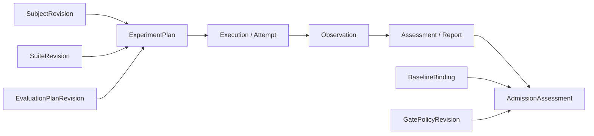

# Decision Lab 架构设计

状态：设计基线，能力按实施计划逐步交付。更新：2026-11-01。

阅读顺序：目标界定问题，原则约束取舍，领域定义业务，系统承载业务，演进约束变更。每项定义有唯一归属，其他章节通过引用使用；实现步骤见 [实施计划](implementation-plan.md)。

## 1. 架构目标与质量要求

### 1.1 平台使命

为生产决策方案提供可复现、可追溯、可审计的评价与回归证据，支撑指定业务范围内的初始准入、版本替换和持续质量治理。核心产出是绑定方案、任务、评价与门禁版本的结论及证据链。

主要使用者是方案开发者、业务/数据负责人、质量工程师、发布审批者和平台运维。平台提供评测与准入依据，业务系统负责实际动作，发布系统负责部署；三者的责任独立。

### 1.2 能力与部署边界

首发支持文本/JSON 的类型化判断与显式单步决策策略，面向单组织受控部署。Jev/CLEF 与 LLM 均可参加符合其能力的任务；任务语义独立于调用协议。生成任务、多步环境和在线反馈是可独立增加的能力。

本地是开发及可选部署形态，当前代码仍是待演进原型。首发覆盖离线评价、回归与准入；生产反馈未接入前不宣称已完成在线质量治理。

### 1.3 质量要求与生产判据

| ID | 要求 | 必须提供的证据 |
| --- | --- | --- |
| Q1 评价可信 | 参考依据有来源，比较条件有效，指标适用于被测行为 | 参考结果验证、数据划分与复核记录、评价版本及指标分母 |
| Q2 执行可靠 | 任务不因页面退出而丢失，部分失败可定位与恢复 | 幂等/并发/故障恢复测试、取消与重试记录 |
| Q3 可追溯 | 结论可关联输入、尝试、原文和评价口径 | 完整证据链、重算结果和修订历史 |
| Q4 访问受控 | 项目数据与凭据按权限使用，重要操作可审计 | 越权测试、服务身份范围、凭据/审计检查 |
| Q5 可运营 | 容量、故障和变更处于可管理范围 | 部署规格下的负载测量、备份恢复及迁移回退演练 |
| Q6 可集成 | 发布流程能够核验准入结论 | CLI/API 集成、版本/有效性校验、例外审批记录 |

支持规模、并发、平台开销、队列等待目标、RPO/RTO 和保留周期在部署规格中确定并验证；提供商延迟与平台自身开销分别计量。生产发布要求 Q1–Q6 在声明的规格下达标，单个工程切口完成不等于生产交付。

## 2. 架构原则

本章定义设计选择的依据；具体业务不变量归属第 3 章，实现机制归属第 4 章。

| 原则 | 理论依据 | 对设计取舍的指导 |
| --- | --- | --- |
| 业务语义决定边界 | 领域驱动设计的限界上下文与聚合 | 先确定职责和一致性要求，再决定服务、接口和表 |
| 对完整方案作结论 | 实验设计对处理条件和混杂因素的控制 | 模型之外的提示、转换和策略也属于被测条件；比较时指出变化因素 |
| 分开观察与评价 | 测量效度：可观察指标与业务目标有区别 | 保存原始事实；判断质量、动作质量和流程效果分别评价 |
| 用业务损失解释取舍 | 决策理论的损失/效用 | 正确率、概率、阈值和动作收益各有含义，关键约束不能被平均成绩抵消 |
| 比较承认不确定性 | 配对实验与统计推断 | 以独立采样单元分析变化；不把相关问题数当独立样本数，不把小样本波动当确定退步 |
| 对部分失败作显式建模 | 分布式系统的部分失败与不可确定结果 | 区分未发生、失败和结果未知，不把本地幂等解释为远端 exactly-once |
| 用最小闭环验证抽象 | 模块化与依赖倒置 | 领域逻辑独立于基础设施；每次扩展完整行为，出现实际需求后再增加抽象 |

## 3. 领域架构

### 3.1 统一语言与限界上下文

| 上下文 | 拥有的概念与职责 | 向其他上下文提供 |
| --- | --- | --- |
| 任务与参考证据 | TaskDefinition 定义输入、允许答案/动作；CaseRevision 是具体样例；ReferenceEvidence 是标签、规则、测试或偏好；SuiteRevision 固定集合与数据划分 | 可执行任务与可评价参考依据的版本引用 |
| 被测方案 | SubjectRevision 组合模型引用、任务表达/提示、输出转换与可选决策策略；能力声明说明可接受任务和证据种类 | 被测条件的版本引用；调用所需的非秘密配置与 CredentialRef |
| 实验与执行 | ExperimentPlan 定义方案、任务集、重复/采样、预算和执行策略；Execution 是方案×场景×轮次；Attempt 是一次实际尝试；Observation 是其原始观测 | 输入快照、执行状态和原始证据 |
| 评价与分析 | EvaluationPlanRevision 指定证据要求与 Evaluator；Assessment 是逐项评价；Report 是指定口径的汇总 | 可追溯评价、指标与比较所需明细 |
| 回归与准入 | BaselineBinding 指定比较起点；GatePolicyRevision 定义回归规则、关键切片及门禁；AdmissionAssessment 是准入结论；Approval/Exception 是人工批准或例外 | 绑定版本、适用范围和有效性的结论 |

模型提供商属于方案配置，不构成业务上下文。Endpoint、凭据管理、身份和审计是支撑能力，其实现归第 4 章。

### 3.2 核心聚合、关系与不变量

| 聚合根 | 负责保证的不变量 |
| --- | --- |
| EvaluationSuite | 发布集合中的场景、参考依据、顺序和划分完整且固定 |
| EvaluationSubject | 已发布的模型、任务表达、转换和策略引用固定；密钥只以引用出现 |
| Experiment | 计划创建后冻结；相同幂等请求不重复创建；执行单元按计划唯一展开 |
| Execution | 同一方案/场景/轮次唯一；每次重试新增 Attempt；只有有效执行代次能提交当前结果 |
| EvaluationReport | 明确证据范围、评价版本与指标分母；新评价产生新修订，保留旧报告 |
| GatePolicy | 比较方法、容差、关键约束、样本要求及不确定性处理在实验前发布 |
| AdmissionAssessment | 版本绑定与适用范围完整；不得因证据不足而通过；人工例外不改变机器报告 |

聚合内是事务一致性边界；跨上下文用 ID 和版本引用协作。Experiment 不包含需要整体更新的全部响应，Execution 独立管理其生命周期。

### 3.3 评测、回归与准入流程

**评测：** 校验任务与方案能力兼容，冻结实验，执行并保存观测，再按评价方案产生逐项评价与报告。规则、程序、人评、模型裁判都是 Evaluator，各自记录版本和有效性；裁判失败归为评价错误。

指标按下表定义，取消、未开始和缺少参考依据的判断单独显示。重试增加尝试数，不增加任务判断分母；首次尝试与按预定策略选定的尝试分别报告，不择最高分。

| 指标 | 计量口径 |
| --- | --- |
| 调用成功率 | 成功的提供商业务响应 / 已终结且实际发出的尝试；不确定尝试单列且不计成功 |
| 输出有效率 | 符合契约的判断 / 已终结且开始执行单元中的计划判断 |
| 有效判断准确率 | 正确判断 / 有效且具有适用参考依据的判断 |
| 端到端成功率 | 成功判断 / 已终结且开始执行单元中的计划判断；执行、解析与评价错误分别列因且不计成功 |
| 决策与流程效果 | 按任务约定的成本、约束、终止条件和可用证据计量 |
| 概率、耗时与用量 | 各指标声明所需证据、样本数和范围；证据缺失为不适用，未知不填 0 |

具体 Brier/NLL/ECE、Score 判分和聚合公式由版本化 EvaluationPlan 定义。候选概率、token 概率、自述置信度分别声明来源；接口 confidence 不等同正确概率。

**回归：** 在相同任务与评价版本上逐例配对基线和候选，识别保持、修复、退步和共同失败；独立检查关键切片。基线不代替参考依据。数据/标签版本变化时应显式重建可比实验，不直接比较旧总分。最低样本、容差及统计方法预先固定；调规则与调阈值的数据同最终测试集隔离。

**准入：** 根据固定政策评价报告。四种互斥结论按以下顺序判定，保留全部命中原因：

| 顺序 | 结论 | 条件 |
| --- | --- | --- |
| 1 | failed | 可靠证据已证明违反强制条件；确定违规与统计退步按政策分别认定 |
| 2 | blocked | 没有已证明违规，但执行/评价不可完成，必要证据缺失、过期或版本不匹配 |
| 3 | inconclusive | 前两类不适用，但样本量或统计依据不足，需要复核 |
| 4 | passed | 前三类均不适用，全部强制条件满足且证据充分 |

结论绑定方案、任务、评价、门禁版本、报告、适用业务及有效期。外部发布流程先核验绑定关系；人工例外记录责任人、理由、范围与期限。生产反馈经授权、脱敏、标注与复核进入新任务版本；分布变化只是调查线索，不直接证明正确率下降。

### 3.4 状态、版本与证据生命周期

**版本：** 可发布定义经历 draft → published → retired。published 内容不可原地覆盖，修改产生新 revision；retired 版本不供新实验选用，但仍可支撑历史复算。模型实际 revision 无法获得时记录未知，不承诺权重级复现。凭据轮换只改变密钥修订引用，不改写既有尝试的使用记录。

**执行：** Execution 使用 queued、running、retry_wait、succeeded、failed、interrupted、cancelled。答错不导致技术执行失败；请求、契约校验或评价异常记录独立错误阶段，部分有效结果仍保留。Experiment 根据执行进度与暂停/取消控制派生状态。

暂停停止新领取并等待在途请求结束；取消尽力中止在途调用，未开始项终止。重试新增 Attempt；晚到响应可保留，但不得覆盖取消终态或失效执行代次。

**证据：** 原始观测一旦持久化即保留身份与内容指纹；归一化、评价及报告是带版本的派生物。重算不修改原文或覆盖旧评价。退役、过期、撤销只改变使用资格；证据清理由授权的留存策略执行，有审计记录，不能在已宣称仍有效的证据链上静默删除。

## 4. 系统架构

### 4.1 组件职责与依赖方向

| 组件 | 实现职责 |
| --- | --- |
| Web / CLI / API | 身份与输入校验、用例入口、进度和报告展示；不拥有权威队列与评分 |
| 应用服务 | 编排第 3 章用例、事务边界与跨聚合协作 |
| 领域模块 | 契约、状态规则、归一化、评价与门禁逻辑；不依赖 UI、SQL 或网络 |
| Scheduler / Worker | 领取、限流、预算、超时、租约与取消控制 |
| Model adapter | 将任务投影到提供商协议并解析原始响应；只能访问允许发送的输入 |
| Repository / Evidence store | 版本、队列、尝试、原文、评价、报告与审计的持久化 |
| Credential store / Identity provider | 按项目和服务身份授权访问凭据与数据 |

领域声明所需接口，由基础设施实现；应用服务负责组装。起步阶段使用直接应用调用，出现可靠异步交付需求时再引入事件与事务 outbox，消费端幂等。API 与 Worker 生命周期逻辑解耦，可按部署规格合并或分进程。

### 4.2 存储、调度与故障恢复

持久状态是事实来源，通知只提示变化。实验创建与执行展开使用短事务；唯一约束保证身份唯一，幂等键约束重复提交，租约 generation 约束执行权，分别验证。

领取时提交 Attempt 和租约后再请求网络，不在网络等待期间持有事务。先保存原文再评价；原文与元数据分存时需明确提交状态、校验和与孤儿清理。数据库驱动不得改变领域状态语义。

| 故障/控制场景 | 恢复机制 |
| --- | --- |
| 页面关闭 | 服务端 Worker 继续；页面重连查询同一实验 |
| 原文已落盘，评价前退出 | 恢复本地评价，不重复请求模型 |
| 在途请求无持久响应 | 按第 3.4 节记录 interrupted/outcome_unknown，默认显式重试；远端可能已计费 |
| 明确限流拒绝 | 仅在提供商语义允许时按冻结策略退避并记录尝试 |
| 凭据/配置无效 | 暂停受影响方案，其他方案继续 |
| 取消或旧 Worker 晚到 | 用终态和代次条件拒绝覆盖，必要时仅附存响应证据 |

恢复默认不保证远端调用 exactly-once；测试以 Q2/Q3 的约定为依据覆盖进程退出、租约过期、重复提交和部分落盘。

### 4.3 权限、凭据与审计

每条业务记录携带 project_id、操作者和来源，所有入口在服务端鉴权。项目是数据范围，用户与 CI 服务身份分别授权；任务集盲测数据、原始证据、政策发布和例外批准按职责控制访问。

凭据只在服务端解析，不回传 UI，不进入观测、日志和普通导出。Adapter 无权读取参考答案。数据导入/反馈遵循授权、脱敏和留存策略。重要变更记录对象版本、操作者、时间和因果 ID；追加式应用审计不等同于防篡改保证。共享访问开放前验证 Q4。

### 4.4 部署、可观测性与运维

保留当前 Node.js 环境与页面，通过兼容层渐进迁移。首个单机切口验证 SQLite 的事务、唯一约束、恢复与备份；共享/多副本规格需独立存储评审，不自动继承适用结论。

服务端保持常驻时页面退出可继续执行；电脑休眠、服务退出或关机进入恢复语义。部署记录 API/Worker 拓扑、持久盘、并发与提供商配额、支持数据规模及升级路径。

通过 request/experiment/execution 关联 ID 观测队列等待、分阶段耗时、错误、重试、用量及容量。日志、用户证据和审计分别设定访问/保留策略；以在线一致性备份或受控停写备份验证恢复，迁移失败可回滚。按 Q5/Q6 的部署规格进行容量、故障演练和 CI 集成验证。

## 5. 演进约束与重要决策

### 5.1 兼容与迁移

已发布任务与方案引用旧版本规则；新契约、归一化、评价和政策产生新版本。重评估明确选择目标版本并保留原报告，不静默更新历史成绩。

旧 localStorage 数据先预览、按来源/原 ID/内容指纹去重导入并标明 legacy 版本；成功前保留原数据。迁移以服务端为单一权威，避免长期双写；历史示例与用户实验分开。

### 5.2 扩展与文档纪律

新增能力先说明业务问题、所属上下文及受影响契约，再实现最小用例。生成任务通过新的任务/评价契约加入；多步任务增加轨迹、环境与终止语义，不能以增加独立 questions 代替。

本文是架构约定的唯一来源；实施计划只记录当前切口及证据，README 只说明已实现的使用方式。每周验证一个闭环并据结果调整计划。重要决策在第 5.3 节记录问题、选择、理由、代价与重审条件，避免平行文档重复定义。

### 5.3 重要决策记录

| 决策 | 选择与理由 | 代价与重审条件 |
| --- | --- | --- |
| D1 领域优先 | 用例、契约和不变量先于技术拓扑；系统接口服从第 3 章 | 前期需明确语义；真实用例与模型冲突时修订契约 |
| D2 增量迁移 | 保留现有页面和可复用逻辑，先完成一条服务端证据链 | 需要临时兼容层；新链路稳定且数据迁移完成后移除 |
| D3 起步部署 | 先验证单机持久化与一个执行者，保持职责可分离 | 不提供未经验证的多副本承诺；部署规格或容量要求超出时重新评审 |
